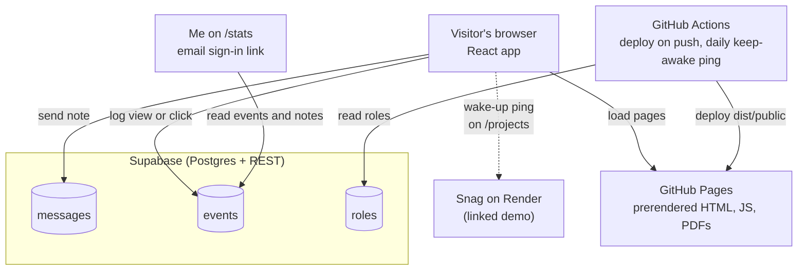
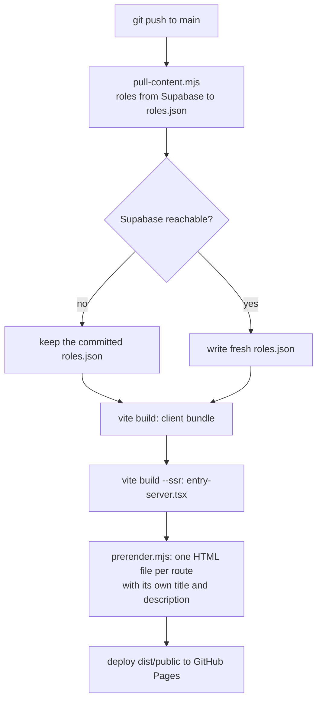

# buildwithrez

My portfolio site: product internships, projects and education, with my resume one click away.

**Live:** [www.buildwithrez.com](https://www.buildwithrez.com)

**Contents:** [Run it locally](#run-it-locally) · [Hero arrange mode](#hero-arrange-mode) · [Architecture](#architecture) · [How a page gets built](#how-a-page-gets-built) · [Database](#database) · [Editing content](#editing-content) · [Analytics](#analytics) · [Deploying](#deploying) · [Project layout](#project-layout)

## What it does

- **Five pages.** Home, Experience, Projects, Education, and MBA projects.
- **Hero scene.** A centred photo with faint frosted cards of my real work floating around it, placed with an in-browser arrange mode.
- **Shipped work.** The home page lists only work that launched, each row linking to the details.
- **Resume first.** The one red button on the site downloads my resume PDF. Education also offers a redacted unofficial transcript.
- **Contact.** Email, LinkedIn and resume up front; a note form opens one click away and saves to the database.
- **Visit analytics.** Page views and key clicks (resume, Snag, email, LinkedIn) are counted, with no cookies and no personal data.
- **Content from a database.** Experience roles live in a Supabase table and are pulled in at build time.
- **Private stats page.** `/stats` is unlisted and sign-in only. It charts visits, ranks pages, shows the latest resume downloads, and compares day by day.

## Run it locally

Requires Node 20.

```sh
npm install
npm run dev
```

Open http://localhost:5000. Analytics are off in dev, so local testing never shows up in the numbers.

## Hero arrange mode

Open any copy of the site with `?arrange` (for example http://localhost:5000/?arrange) to drag the hero background cards and tick or untick each one. The layout saves in that browser and can be copied as JSON. Paste it into `client/src/components/hero-layout.ts` and push to publish it. Visitors never see the arrange panel.

## Architecture

The site is static. GitHub Pages serves prerendered HTML, and React takes over in the browser. The only backend is Supabase. Visitors' browsers write notes and events, the build reads roles once, and the private `/stats` page reads events and notes after I sign in.



### Design decisions

- **Static over a server.** Nothing on the site changes per visitor, so there is no server to run, pay for, or wake up.
- **No SDK on public pages.** Two `fetch` calls in `client/src/lib/db.ts` cover what visitors need. The Supabase SDK and Recharts load only with the `/stats` chunk.
- **Public key, locked tables.** The publishable key ships in the page on purpose. Row-level security lets visitors insert notes and events and read published roles. Only my signed-in email can read events and notes, and public sign-ups are off.
- **Content at build time.** Roles are fetched during the build, not on page load, so pages stay fast and still work if Supabase is down.
- **Restrained motion.** Hovers are 150ms colour fades, and content below the fold fades in once as it scrolls into view. Everything turns off when the visitor's system asks for less motion.
- **Type.** Raleway for headings, Manrope for body text, JetBrains Mono for small labels such as dates and tool lists. All three are self-hosted.

## How a page gets built



## Database

One free Supabase project (`buildwithrez`, us-east-1).

| Table | Holds | Visitors can |
|---|---|---|
| `messages` | Contact form notes: name, email, message, read flag | insert only |
| `events` | One row per page view or tracked click: type, path, referrer | insert only |
| `roles` | Experience page entries: title, company, dates, scope, metrics, tools | read published rows |
| `event_summary` (view) | Totals per event and page, plus the last 7 days | nothing |

Checks in the database reject bad input: field lengths, email format, and a fixed list of event types. The contact form also has a hidden field that bots fill in and people don't.

## Editing content

1. Open the `roles` table in the Supabase Table Editor and edit a row. Use `sort` for order and `published` to hide a role.
2. Rebuild the site: GitHub, then **Actions**, then **Build and Deploy to GitHub Pages**, then **Run workflow**.

Logos and photos stay in code, matched by company name in `client/src/pages/experience.tsx`. A new company needs a logo added there.

Everything else (projects, education, home) is still written directly in the page files.

## Analytics

The easiest view is **www.buildwithrez.com/stats**: enter my email, click the link it sends, and the dashboard shows today vs yesterday, the latest resume downloads, pages ranked by views, a day-by-day table and the latest 25 events. Times there are New York time.

The raw data is also in the Supabase Table Editor: `event_summary` for totals and `events` for each visit. Times are stored in UTC. Event types are `page_view`, `resume_download`, `snag_open`, `email_click`, `linkedin_click` and `contact_sent`.

## Deploying

Every push to `main` runs `.github/workflows/deploy.yml`, which builds the site and publishes `dist/public` to GitHub Pages at www.buildwithrez.com. If a run fails on a network error, re-run it from the Actions tab.

Free-tier note: Supabase pauses a free project after about a week with no traffic. `.github/workflows/keep-supabase-awake.yml` reads one row every morning so that never happens. GitHub turns off scheduled workflows in a repo with no commits for 60 days, so re-enable it from the Actions tab after a long break. If the project does pause, the form shows an email fallback and the build uses the saved roles until it is restored from the dashboard.

## Project layout

```
client/
  index.html             HTML entry
  public/                Favicons, fonts, sitemap, PDFs and screenshots (served as is)
  src/
    App.tsx              Routes, page transitions, analytics listener, scroll reveal
    entry-server.tsx     Server render used by the prerender step
    main.tsx             Browser entry
    index.css            Design tokens and shared styles
    components/          Nav, hero, contact form and other sections
      hero-backdrop.tsx  Hero background cards and arrange mode
      hero-layout.ts     Where each hero card sits (edit via arrange mode)
    pages/               One file per route
    data/roles.json      Roles pulled from Supabase (committed as a fallback)
    lib/db.ts            Supabase calls: send a note, log an event
    lib/supabase.ts      Supabase client, used only by /stats
    pages/stats.tsx      Private analytics dashboard
    lib/site.ts          Email and resume path
scripts/
  pull-content.mjs       Fetches roles before the build
  prerender.mjs          Writes an HTML file for every route
.github/workflows/
  deploy.yml             Build and deploy on push to main
  keep-supabase-awake.yml  Daily ping so the free database never pauses
vite.pages.config.ts     Build config
tailwind.config.ts       Tailwind theme
PRODUCT.md               Product and design brief for the site
```

## Stack

React 18, TypeScript, Vite 5, Tailwind CSS 3, wouter for routing, framer-motion for motion, lucide icons, Recharts for the stats charts, and Supabase for data and sign-in.
