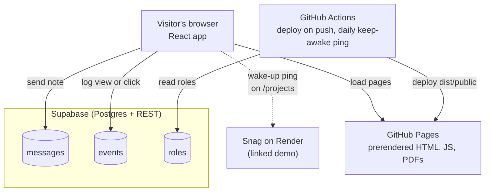
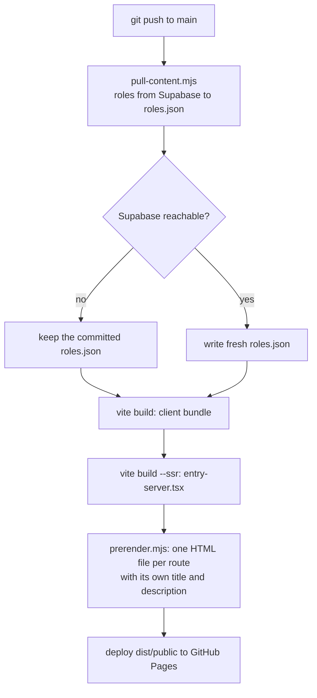

# buildwithrez

My portfolio site: product internships, projects and education, with my resume one click away.

**Live:** [www.buildwithrez.com](https://www.buildwithrez.com)

**Contents:** [Run it locally](#run-it-locally) · [Architecture](#architecture) · [How a page gets built](#how-a-page-gets-built) · [Database](#database) · [Editing content](#editing-content) · [Analytics](#analytics) · [Deploying](#deploying) · [Project layout](#project-layout)

## What it does

- **Five pages.** Home, Experience, Projects, Education, and MBA projects.
- **Resume first.** The main button downloads my resume PDF.
- **Contact form.** Visitors can leave a note, which is saved to the database. Email and LinkedIn links sit next to it.
- **Visit analytics.** Page views and key clicks (resume, Snag, email, LinkedIn) are counted, with no cookies and no personal data.
- **Content from a database.** Experience roles live in a Supabase table and are pulled in at build time.

## Run it locally

Requires Node 20.

```sh
npm install
npm run dev
```

Open http://localhost:5000. Analytics are off in dev, so local testing never shows up in the numbers.

## Architecture

The site is static. GitHub Pages serves prerendered HTML, and React takes over in the browser. The only backend is Supabase, which the browser calls directly for two writes (notes and events) and the build calls once for content.



### Design decisions

- **Static over a server.** Nothing on the site changes per visitor, so there is no server to run, pay for, or wake up.
- **No Supabase SDK.** Two `fetch` calls in `client/src/lib/db.ts` cover everything the site needs.
- **Public key, locked tables.** The publishable key ships in the page on purpose. Row-level security lets visitors insert notes and events and read published roles, and nothing else.
- **Content at build time.** Roles are fetched during the build, not on page load, so pages stay fast and still work if Supabase is down.
- **Reduced motion respected.** Animations turn off when the visitor's system asks for less motion.

## How a page gets built



## Database

One free Supabase project (`buildwithrez`, us-east-1).

| Table | Holds | Visitors can |
|---|---|---|
| `messages` | Contact form notes: name, email, message, read flag | insert only |
| `events` | One row per page view or tracked click: type, path, referrer | insert only |
| `roles` | Experience page entries: title, company, dates, scope, metrics, tools | read published rows |
| `event_summary` (view) | Totals per event and page, plus the last 7 days | nothing |

Checks in the database reject bad input: field lengths, email format, and a fixed list of event types. The contact form also has a hidden field that bots fill in and people don't.

## Editing content

1. Open the `roles` table in the Supabase Table Editor and edit a row. Use `sort` for order and `published` to hide a role.
2. Rebuild the site: GitHub, then **Actions**, then **Build and Deploy to GitHub Pages**, then **Run workflow**.

Logos and photos stay in code, matched by company name in `client/src/pages/experience.tsx`. A new company needs a logo added there.

Everything else (projects, education, home) is still written directly in the page files.

## Analytics

Open the Supabase Table Editor:

- `event_summary` for totals.
- `events` for each visit, newest first when sorted by `created_at`.

Times are stored in UTC. Event types are `page_view`, `resume_download`, `snag_open`, `email_click`, `linkedin_click` and `contact_sent`.

## Deploying

Every push to `main` runs `.github/workflows/deploy.yml`, which builds the site and publishes `dist/public` to GitHub Pages at www.buildwithrez.com. If a run fails on a network error, re-run it from the Actions tab.

Free-tier note: Supabase pauses a free project after about a week with no traffic. `.github/workflows/keep-supabase-awake.yml` reads one row every morning so that never happens. GitHub turns off scheduled workflows in a repo with no commits for 60 days, so re-enable it from the Actions tab after a long break. If the project does pause, the form shows an email fallback and the build uses the saved roles until it is restored from the dashboard.

## Project layout

```
client/
  index.html             HTML entry
  public/                Favicons, fonts, sitemap, PDFs and screenshots (served as is)
  src/
    App.tsx              Routes, page transitions, analytics listener
    entry-server.tsx     Server render used by the prerender step
    main.tsx             Browser entry
    index.css            Design tokens and shared styles
    components/          Nav, hero, contact form, cursor and other sections
    pages/               One file per route
    data/roles.json      Roles pulled from Supabase (committed as a fallback)
    lib/db.ts            Supabase calls: send a note, log an event
    lib/site.ts          Email and resume path
scripts/
  pull-content.mjs       Fetches roles before the build
  prerender.mjs          Writes an HTML file for every route
.github/workflows/
  deploy.yml             Build and deploy on push to main
  keep-supabase-awake.yml  Daily ping so the free database never pauses
vite.pages.config.ts     Build config
tailwind.config.ts       Tailwind theme
PRODUCT.md               Product and design brief for the site
```

## Stack

React 18, TypeScript, Vite 5, Tailwind CSS 3, wouter for routing, framer-motion for motion, lucide icons, and Supabase for data.
